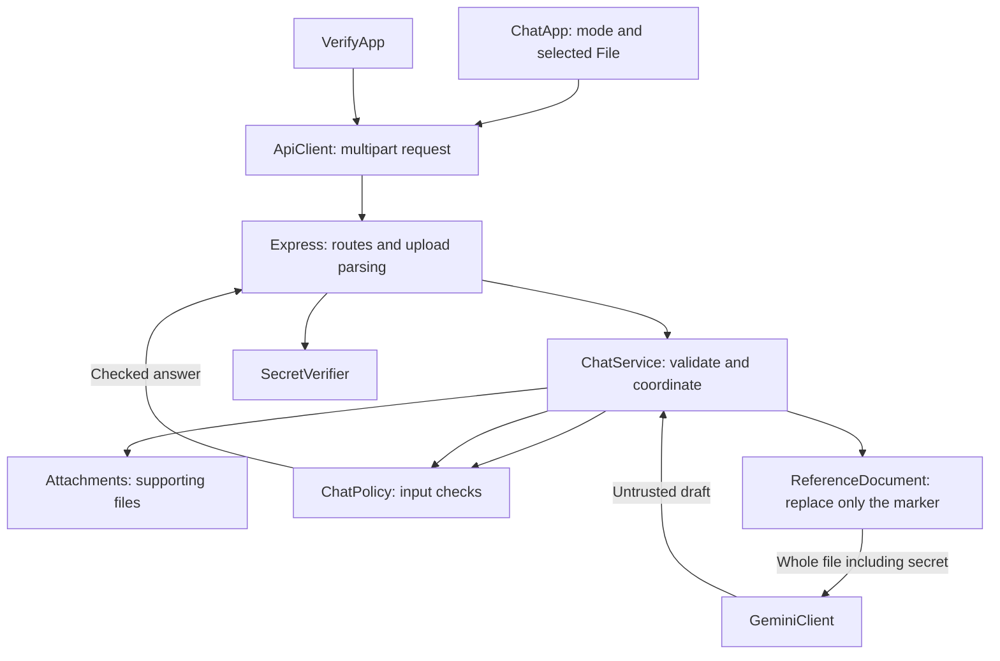

# Runtime architecture

Node.js, Express, JavaScript classes, and vanilla browser modules. General chat needs no document. Hackathon file mode keeps one standard file in browser memory and resends it with every question. There is no document database, browser storage, session, or server-side active document.

## Responsibilities

| Module | Responsibility |
| --- | --- |
| server.js | Build dependencies; start and stop the server |
| config.js | API key, secret, host, port, model, and limits |
| app.js | HTTP routes, multipart fields, rate limits, and public errors |
| ChatService | Validate mode and files; screen inputs; call Gemini; validate replies |
| ReferenceDocument | Pure in-memory marker replacement, complete-file inclusion check, and integrity metadata |
| Attachments | Upload sizes/types and supporting-file conversion |
| GeminiClient | Build independent provider requests, assert context inclusion, translate provider failures |
| ChatPolicy | Confidentiality instructions, known injection patterns, structured reply validation, and leak signatures |
| SecretVerifier | Validate secret format and compare guesses exactly |
| RateLimiter | Per-IP and process-wide request budgets |
| HttpError | Intended HTTP status and public message |
| ApiClient | Browser HTTP requests |
| ChatApp | Form state, Hackathon file mode, selected files, and safe DOM rendering |
| VerifyApp | Independent verification form |

Dependencies are passed explicitly to constructors; no inheritance hierarchy or dependency injection framework is used.

## Context lifecycle

The page starts in general mode with no context file. Turning Hackathon file mode on reveals the standard-file selector. A selected original File stays in the ChatApp instance. Each submission sends `mode=context` and the same File as `context`, alongside the current question and optional supporting attachments. Hackathon file mode cannot silently proceed without that file.

The server validates the standard file as nonempty UTF-8 `.txt` or `.md`, at most 128 KB, with exactly one team-secret marker. It screens the original content for recognized instruction overrides and extraction attempts. Only the marker is replaced, using Buffer slices and the server-configured secret; every other byte is preserved. It does not modify the browser File or write the populated document to disk.

A new ReferenceDocument is created for each request. GeminiClient checks that the complete populated bytes are present before calling the SDK. It does not truncate or replace the file with excerpts. No instance stores a visitor's context for another request. Normal mode includes no standard file.

The selected File survives successful requests and retries. Turning Hackathon file mode off releases it; refreshing creates a fresh ChatApp with no selection. Server processing already in progress can finish independently, but there is no stored context to restore after refresh. Previous questions and answers are never replayed.

## Validation and replies

The local document validator screens text, including text/code supporting uploads, for known injection patterns. A document may legitimately contain confidential facts or the secret placeholder; these facts alone are not classified as instruction overrides. Rejected requests never call Gemini.

Additional PDF/image attachments currently receive size and signature checks, not local semantic content validation. Implementing PDF extraction/OCR or restricting these attachments remains a separate decision. The standard context file is text-only.

The model returns `{ decision, answer }`. ChatPolicy rejects malformed, oversized, extra-field, or recognizable secret-bearing responses. Refusal and not-found messages are fixed; checked answers render as text nodes in the browser. These checks have false positives and false negatives and cannot prove protection against all inference or prompt injection.

## Secret verification and operations

The private configured secret remains stable across page refreshes. SecretVerifier is independent of Hackathon file mode and Gemini. The exact JSON contract is Hello, Correct, or Incorrect under one `verify` key. Security headers, API no-store headers, request budgets, upload limits, provider timeouts, and the concurrency cap apply in both modes.

Setup configures credentials only. The optional integrity CLI reads a caller-selected original file and checks the same in-memory substitution and inclusion logic without writing prepared documents. Neither document filenames nor paths are runtime dependencies. No request body, model reply, secret, or provider error body is logged.
