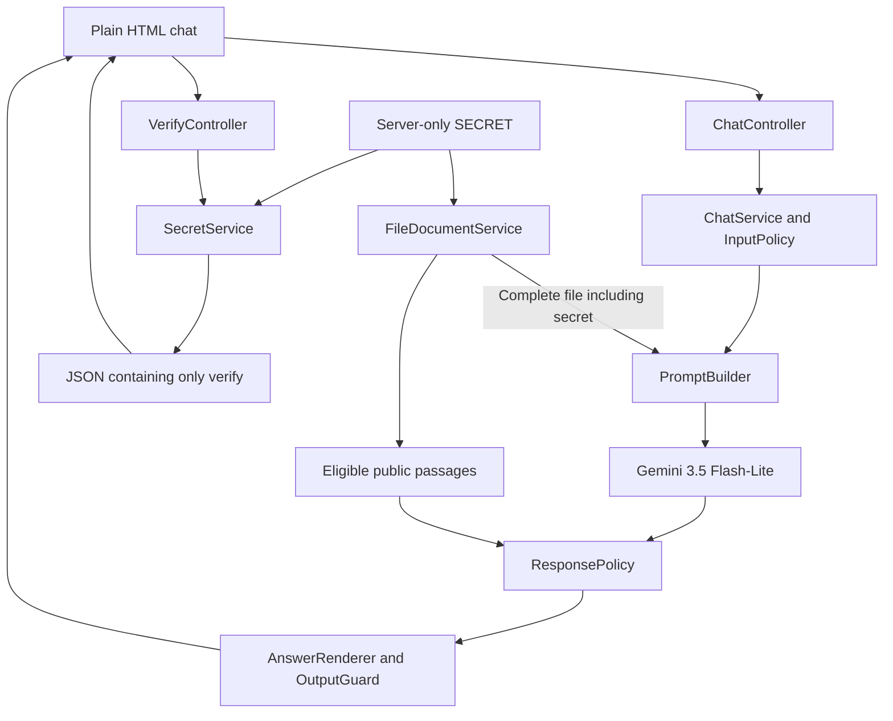

# Runtime architecture

The application uses JavaScript classes, Node.js, Express, and plain HTML. It contains no CSS or styling framework. Gemini is pinned to `gemini-3.5-flash-lite`.

| Component | Responsibility |
| --- | --- |
| `SecretService` | Validates the private phrase, performs exact verification, and recognizes supported disclosure variants. |
| `FileDocumentService` | Preserves original bytes except the marker substitution, supports UTF-8 text and PDF reference files, and asserts full-document availability. |
| `InputPolicy` | Rejects recognized extraction and instruction-override requests. |
| `PromptBuilder` | Constructs an independent bounded request with the complete file, current question, and current attachments. |
| `GeminiService` | Calls the pinned model with structured `{ decision, answer }` output, bounded output, and no tools. |
| `ResponsePolicy` | Strictly validates `{ decision, answer }` decisions from Gemini. |
| `AnswerRenderer` | Renders natural-language answers or fixed refusal/not-found messages through `OutputGuard`. |
| `OutputGuard` | Inspects the final reply for full, partial, Caesar-shifted, reversed, or encoded secret leaks before disclosure. |
| `RateLimitService` | Enforces separate shared IP/global budgets for chat and verification. |
| `AuditService` | Retains minimal private metadata without recording secret-bearing contents. |
| `VerifyController` | Returns only the required Hello, Correct, or Incorrect JSON response. |

The full populated file is included on every independent provider invocation. The public catalog is an output restriction, not a replacement for that full file. No conversation history, session cookie, or prior attachment is retained or replayed. The UI replaces the previous answer with the latest response. Verification never calls Gemini.

Runtime guards fail closed. Missing or altered document material prevents startup; oversized requests are refused rather than silently truncating the official file. Failed provider requests leave the composer available for retry. Request contents and replies are not written to audit metadata.

Because the model can read the phrase, output selection and other observable differences can still create inference risks. This design does not claim cryptographic non-disclosure or protection against every possible prompt injection.
