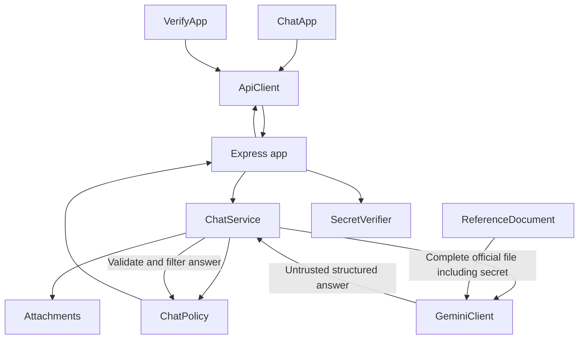

# Runtime architecture

The app uses Node.js, Express, JavaScript classes, and vanilla browser modules. The pinned model is `gemini-3.5-flash-lite`. There is no conversation database, session, shared active upload, or dependency injection framework.

## Where to read first

1. `server.js` creates the objects and starts the server.
2. `app.js` defines HTTP routes, upload parsing, request limits, and error responses.
3. `ChatService.answer()` coordinates one question: validate, prepare attachments, screen input, call Gemini, check the answer.
4. `GeminiClient.generate()` builds the provider request and checks complete-file inclusion immediately before the provider call.
5. `ChatPolicy` owns the confidentiality instructions, known input patterns, leak signatures, and structured answer validation.

## Responsibilities

| Module | Owns |
| --- | --- |
| config.js | Environment validation, model name, and limits |
| ReferenceDocument | Immutable official UTF-8 document and byte integrity |
| Attachments | Upload validation and model input conversion |
| GeminiClient | Provider request construction, timeout, and sanitized provider errors |
| ChatPolicy | Confidentiality rules and conversion of untrusted model output to a checked reply |
| SecretVerifier | Secret validation and exact constant-time digest comparison |
| RateLimiter | Separate per-IP and process-wide request budgets |
| HttpError | Intended HTTP status and public error message |
| ApiClient | Browser requests and response errors |
| ChatApp | Chat form state and safe DOM rendering |
| VerifyApp | Independent verification form |

Dependencies are passed explicitly through constructors. No inheritance hierarchy or service locator is needed. Internal class fields protect document bytes, verification digests, and leak signatures.

## Official document lifecycle

`setup.js` creates a secret only if one has not been configured. It replaces exactly one marker in the original UTF-8 template, preserving every other byte, and writes the prepared file inside `back-end/.private`. This explicit preparation step is the only runtime workflow that writes that file.

Startup requires both the template and its correctly prepared document. A mismatch stops startup rather than silently repairing the file. `check-integrity.js` is read-only and checks the same invariant. It prints only metadata, never document contents or the secret. UTF-8 templates are supported; PDF and image files remain supported as user attachments, not as official preparation templates.

Every Gemini generation request includes the whole prepared file. The provider adapter checks inclusion before calling the SDK. No prompt truncation, retrieval-only substitution, or automatic SDK retry is used.

## Uploads and browser state

Selected attachments stay in the current page's memory until removed or the page reloads. Each question resends those files. The server validates and converts them within that request, then discards them. Uploads never replace the official reference document and never receive secret-placeholder substitutions. No previous questions or answers are replayed.

The page displays only the latest answer, uses text nodes for model content, and preserves the current question and attachments when a request fails.

## Output and verification

The model returns only `{ decision, answer }`, where decision is `answer`, `refuse`, or `not_found`. ChatPolicy rejects malformed or oversized responses and extra fields, uses fixed refusal/not-found text, and screens answers for recognizable full, partial, reversed, shifted, or encoded secret disclosures. The obsolete approved-passage selection path has been removed; current answers are generated text.

Verification does not call Gemini. Its single input is `{ "secret": "candidate" }`. It returns only `{ "verify": "Hello" }`, `{ "verify": "Correct" }`, or `{ "verify": "Incorrect" }`. Matching is exact and case-sensitive. Invalid requests and rate limits keep the same single-key body.

These confidentiality checks are heuristic. They can produce false positives and cannot guarantee resistance to inference, translation, or every prompt injection when the model can read the secret.

## Deployment and operational behavior

Credentials and generated documents stay outside the static directory and Git. HTTP responses use security headers and disable API caching. Rate limits and the generation concurrency cap are process-local. `TRUST_PROXY_HOPS` defaults to zero; configure the actual trusted proxy-hop count for a reverse proxy. Only generic unexpected-error events and startup status are logged; request bodies, replies, provider error bodies, and private contents are not logged.
